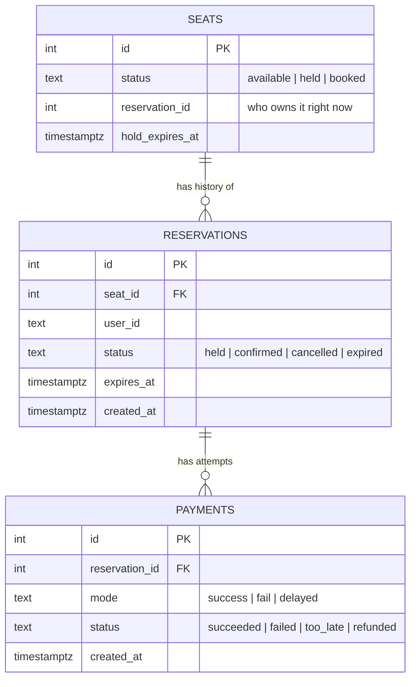
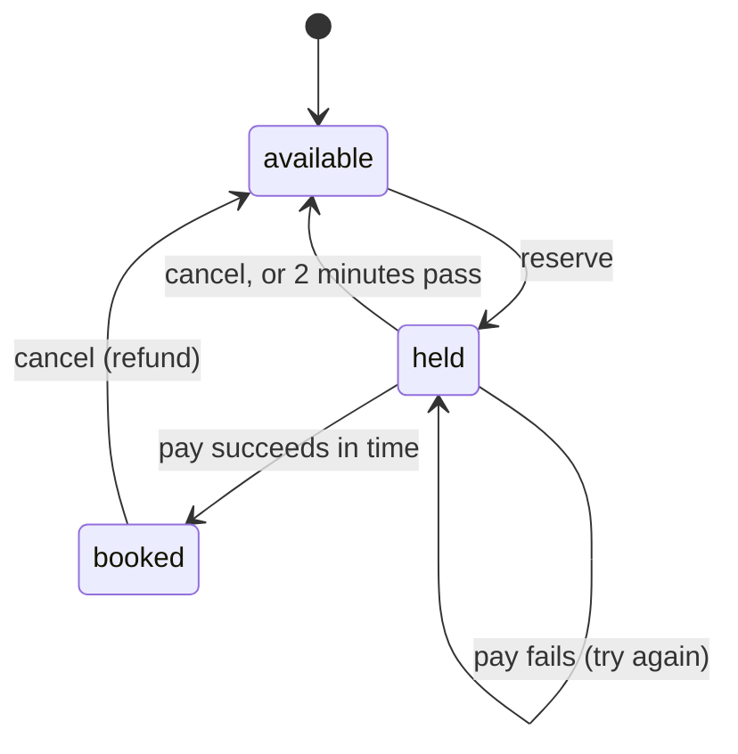

# The Last Seat

A concert ticket booking backend. **500 seats, thousands of students booking at the same time, and no seat is ever booked twice.**

Built with Python (Flask), PostgreSQL, Gunicorn, pytest and Locust.

## Files

| File | What it is |
|---|---|
| `app.py` | The whole backend: every API endpoint and the booking logic |
| `schema.sql` | Creates the database tables and the 500 seats |
| `test_app.py` | Tests, including the concurrency tests |
| `locustfile.py` | Load test (simulates many students booking at once) |
| `requirements.txt` | Python packages |
| `Dockerfile` | Packages the app into a container image |
| `docker-compose.yml` | Starts PostgreSQL and the app together with one command |

## How to run it

### Option 1: with Docker (one command)

You need Docker Desktop.

```bash
docker compose up --build
```

This starts PostgreSQL (and creates the tables and 500 seats from `schema.sql`) and the app on http://localhost:8000. Stop it with `docker compose down`; add `-v` to also delete the data.

### Option 2: without Docker

You need Python 3.10+ and PostgreSQL.

```bash
# 1. Install and start PostgreSQL (macOS with Homebrew)
brew install postgresql@16
brew services start postgresql@16

# 2. Create the database and the tables
createdb lastseat
psql lastseat -f schema.sql          # running this again resets all data

# 3. Install the Python packages
python3 -m venv venv
source venv/bin/activate
pip install -r requirements.txt

# 4. Start the server on http://localhost:8000
export DATABASE_URL=postgresql://localhost/lastseat
gunicorn -w 4 --threads 8 -b 127.0.0.1:8000 app:app
```

For quick development you can also run `python app.py`.

Settings (environment variables): `DATABASE_URL`, `HOLD_SECONDS` (default 120), `PAYMENT_DELAY_SECONDS` (default 3).

## API

Every request that acts for a user sends the header `X-User-Id: <student id>`. This is a stand-in for real login.

| Method | Path | What it does | Responses |
|---|---|---|---|
| GET | `/seats` | Seat map: every seat and whether it is available, held or booked | 200 |
| POST | `/reservations` | Hold a seat for 2 minutes. Body: `{"seat_id": 7}` | 201 held, 200 you already hold it, 409 taken, 404 no such seat, 400 bad body |
| GET | `/reservations/{id}` | Status of one of your reservations | 200, 404 |
| POST | `/reservations/{id}/pay` | Pay. Body: `{"mode": "success"}`, `"fail"` or `"delayed"` | 200 confirmed, 402 payment failed (seat still held), 409 hold expired or cancelled, 404 |
| POST | `/reservations/{id}/cancel` | Cancel; the seat becomes free for others | 200 |
| GET | `/bookings` | Your booking history | 200 |

A missing `X-User-Id` header gets 401.

### Example requests

```bash
curl localhost:8000/seats

curl -X POST localhost:8000/reservations \
  -H 'X-User-Id: alice' -H 'Content-Type: application/json' -d '{"seat_id": 7}'
# 201 {"id": 1, "seat_id": 7, "status": "held", "expires_at": "...", ...}

curl -X POST localhost:8000/reservations \
  -H 'X-User-Id: bob' -H 'Content-Type: application/json' -d '{"seat_id": 7}'
# 409 {"error": "seat is not available"}

curl -X POST localhost:8000/reservations/1/pay \
  -H 'X-User-Id: alice' -H 'Content-Type: application/json' -d '{"mode": "fail"}'
# 402 {"error": "payment failed; your seat is still held, you can try again"}

curl -X POST localhost:8000/reservations/1/pay \
  -H 'X-User-Id: alice' -H 'Content-Type: application/json' -d '{"mode": "success"}'
# 200 {"id": 1, "status": "confirmed", ...}

curl localhost:8000/bookings -H 'X-User-Id: alice'

curl -X POST localhost:8000/reservations/1/cancel -H 'X-User-Id: alice'
# 200 {"id": 1, "status": "cancelled", ...}
```

## Database (ERD)



- **`seats`** says who owns each seat **right now**. This is the table that prevents double booking.
- **`reservations`** keeps **every** reservation ever made, which is the booking history.
- **`payments`** keeps every payment attempt.

## Booking workflow



```mermaid
sequenceDiagram
    participant S as Student
    participant A as API (app.py)
    participant DB as PostgreSQL
    S->>A: POST /reservations {seat_id: 7}
    A->>DB: INSERT reservation (held)
    A->>DB: UPDATE seats SET held WHERE id=7 AND seat is free
    DB-->>A: 1 row changed (won) or 0 rows (lost)
    A-->>S: 201 held / 409 taken
    S->>A: POST /reservations/1/pay
    Note over A: simulated payment (may wait 3 s); no database lock held
    A->>DB: UPDATE seats SET booked WHERE reservation still owns it AND hold not expired
    A-->>S: 200 confirmed / 402 failed / 409 too late
```

## How concurrency is handled

### 1. No seat is ever booked twice
Taking a seat is **one SQL statement** that checks and updates at the same time:

```sql
UPDATE seats SET status = 'held', reservation_id = :id, hold_expires_at = :expiry
WHERE id = :seat AND (status = 'available' OR (status = 'held' AND hold_expires_at < now()))
```

If two students send this for the same seat at the same moment, PostgreSQL **locks the seat row** for the first one. The second one waits. When the first finishes, the second **re-checks the condition** on the updated row, sees the seat is no longer free, and changes **0 rows**. The code reads the number of rows changed: 1 means you got the seat (201), and 0 means someone else did (409).

Why not check first with a SELECT and then UPDATE? Because both students could read "available" before either of them writes, and both would get the seat.

Why not a lock in Python? Gunicorn runs several separate processes, and a Python lock only works inside one of them. The database is the one place every process shares.

### 2. Holds expire automatically
A hold is just a time (`hold_expires_at`, 2 minutes after reserving). Once that time has passed:
- the seat shows as **available** in the seat map;
- the reserve statement above treats it as free, so the next student can take it;
- the old reservation shows as **expired**.

All times come from the database clock (`now()`), so every server agrees on what time it is.

### 3. Payments
- The simulated payment (including the 3 second wait for `delayed`) happens **without holding any database lock or connection**, so a slow payment never blocks anyone else.
- After the payment, the seat is booked **only if this reservation still owns it and the hold hasn't expired**:
  ```sql
  UPDATE seats SET status = 'booked' WHERE id = :seat AND reservation_id = :id AND status = 'held' AND hold_expires_at >= now()
  ```
- If the payment fails, the seat stays held, so the student can try again before the hold runs out (402).
- If a delayed payment finishes **after** the hold expired, nothing is booked, the attempt is recorded as `too_late`, and the student gets 409. In a real system the money would only be captured after the booking succeeds, so they would not be charged.

### 4. Cancellation and reallocation
Cancelling sets the seat back to `available` (and marks any payment `refunded`). The seat can be booked by the next student straight away. The cancel only frees the seat **if this reservation still owns it**, so an old cancel request can never free a seat that now belongs to someone else.

### 5. Repeated requests
Sending the same request again is safe:
- reserving a seat you already hold returns your existing reservation (200);
- paying an already confirmed reservation returns it without paying again, and two payment requests at the same moment produce only one successful payment;
- cancelling twice returns the same cancelled reservation.

## Tests

```bash
createdb lastseat_test
TEST_DATABASE_URL=postgresql://localhost/lastseat_test pytest -q
```

12 tests against a real PostgreSQL database. They wipe `lastseat_test` before each test. They cover: reserving and paying, double booking, failed payment then retry, hold expiry, a delayed payment finishing after expiry, paying twice at once, cancel and reallocation, refund on cancel, an old cancel not freeing someone else's seat, and bad input. The two concurrency tests:
- **200 students try to reserve the same seat at once: exactly 1 succeeds, 199 get 409.**
- **10,000 students reserve 500 seats at once: exactly 500 succeed, and every seat is held exactly once.**

## Load test results

```bash
pip install -r requirements.txt     # includes locust
locust -f locustfile.py --headless -u 1000 -r 100 -t 60s -H http://localhost:8000
```

Each simulated student opens the seat map, tries to reserve a free seat, then pays (60% success, 20% fail, 20% delayed). Run for 60 seconds with 1,000 students, on one laptop (Apple M-series, 10 cores) running PostgreSQL, Gunicorn (4 workers × 8 threads) and Locust together:

| Result | |
|---|---|
| Requests | 42,406 (about 709 per second) |
| Server errors | 0 |
| Failed requests | 17 of 42,406 (0.04%); all were connections reset by macOS before reaching the app (its default queue for new connections is 128) |
| Response time: median / 95th percentile | 3 ms / 140 ms |
| Reserve: median / 95th percentile | 130 ms / 440 ms |
| Pay: 95th percentile | 4.8 s (includes the simulated 3 s delayed payments) |
| Final state | 401 seats booked, 99 held by students whose payment failed (those holds expire after 2 minutes) |
| Double bookings | **0** (401 booked seats = 401 confirmed reservations = 401 successful payments) |

Check for double booking after a run (must return no rows):

```sql
SELECT seat_id FROM reservations WHERE status IN ('held', 'confirmed') GROUP BY seat_id HAVING count(*) > 1;
```

## How it could scale

- **More app servers.** The app keeps nothing in memory between requests, so you can run more copies behind a load balancer. They all use the same database, which is what keeps bookings correct.
- **Database connections.** Each worker keeps up to 10 connections (4 workers × 10 = 40 here). With many servers, keep the total below PostgreSQL's `max_connections`, or add a connection pooler such as PgBouncer.
- **Locking is per seat.** Students fighting over seat 7 don't slow down students booking seat 300, and each lock is held for only a few milliseconds.
- **Next steps:** a reverse proxy (nginx) with rate limiting, caching the seat map for a second or two because everyone reads it constantly, and a waiting queue that lets students in gradually when the portal opens at 6 PM.

## Limitations

- `X-User-Id` is not real authentication. A real system would use a login token (for example a JWT).
- Students are not limited to one seat each.
- Expired holds are not cleaned up by a background job; they are treated as free the moment their time passes. History shows them as `expired`.
