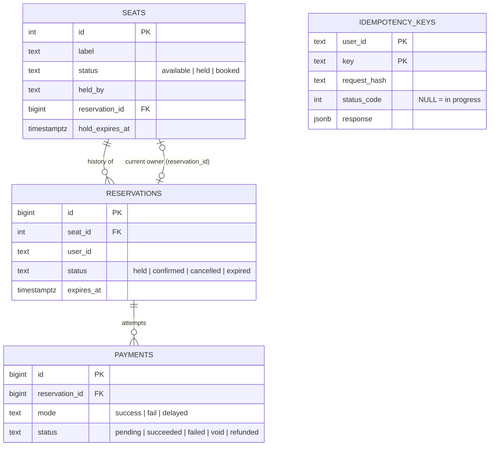
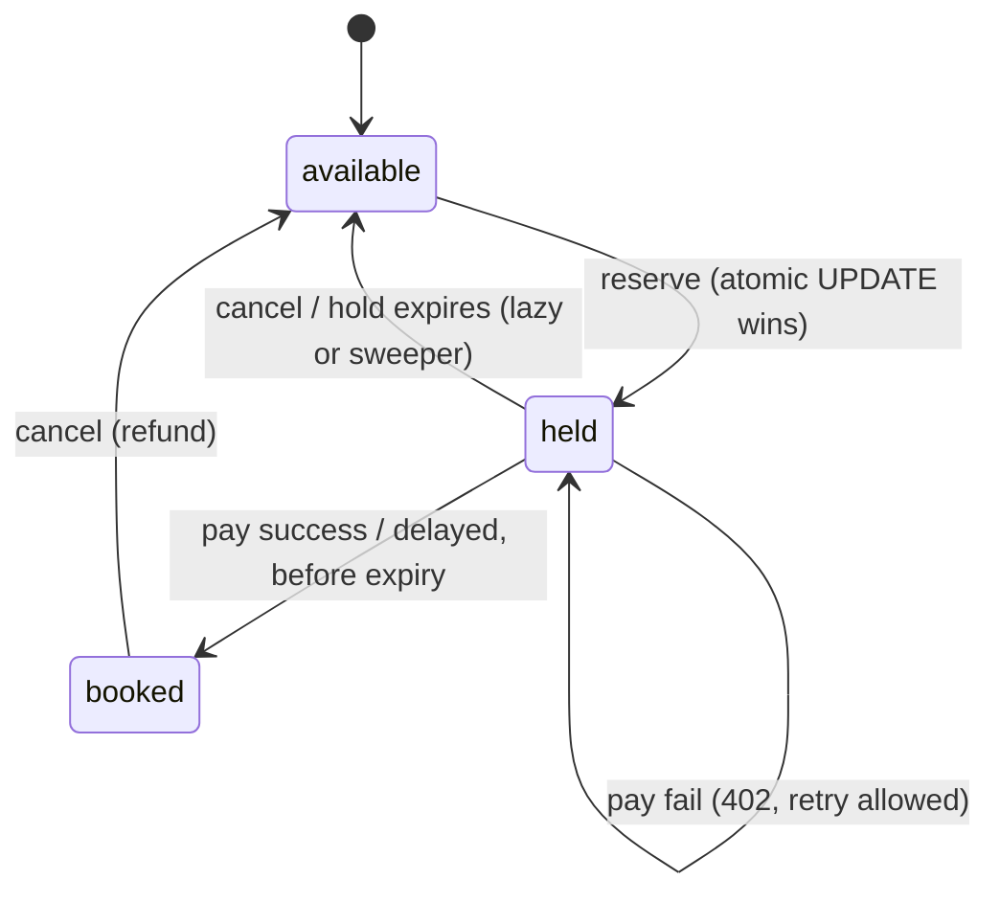

# The Last Seat

Concert ticket booking backend: **500 seats, 10,000 students, no seat ever booked twice.**

Python · Flask · Gunicorn · PostgreSQL 16 · psycopg3 (connection pool) · Docker Compose · nginx · Locust · pytest

## Run it

```bash
docker compose up --build        # db, 2 API replicas, expiry sweeper, nginx on :8080
curl localhost:8080/health
```

Without Docker (needs a local Postgres):

```bash
python -m venv .venv && . .venv/bin/activate && pip install -r requirements-dev.txt
createdb lastseat && psql lastseat -f db/init.sql
export DATABASE_URL=postgresql://localhost/lastseat
gunicorn -k gthread -w 4 --threads 8 -b 127.0.0.1:8000 'app.main:create_app()' &
python -m app.sweeper &
```

Tests (they wipe and recreate the target database's schema, so point them at a throwaway DB):

```bash
createdb lastseat_test
DATABASE_URL=postgresql://localhost/lastseat_test pytest -q
```

## API

Auth is simplified: every request carries `X-User-Id: <student id>`. POST endpoints accept an optional `Idempotency-Key` header.

| Method | Path | What it does | Codes |
|---|---|---|---|
| GET | `/seats` | Seat map + count available | 200 |
| GET | `/seats/{id}` | One seat | 200, 404 |
| POST | `/reservations` | Hold a seat. Body `{"seat_id": 7}` | 201 new hold, 200 already yours, 409 taken / you already have one, 404, 422 |
| GET | `/reservations/{id}` | Reservation status | 200, 404 |
| POST | `/reservations/{id}/pay` | Body `{"mode": "success" \| "fail" \| "delayed"}` | 200 confirmed, 402 declined (hold kept), 409 payment in progress or hold expired mid-payment (payment voided), 410 hold gone |
| POST | `/reservations/{id}/cancel` | Cancel hold or booking; seat goes back to the pool; captured payment marked refunded | 200 (repeatable) |
| GET | `/users/me/bookings` | Booking history | 200 |
| GET | `/health` | DB reachable | 200, 503 |

Also: 401 missing/invalid user, 422 bad body or Idempotency-Key reused with a different body, 429 rate limit (nginx), 503 pool exhausted.

```bash
U=(-H 'X-User-Id: alice' -H 'Content-Type: application/json')   # works in bash and zsh
curl -s localhost:8080/seats | head -c 200
curl -s "${U[@]}" -H 'Idempotency-Key: r-1' -d '{"seat_id": 7}' localhost:8080/reservations
# {"id":1,"seat_id":7,"status":"held","expires_at":"...","user_id":"alice",...}
curl -s "${U[@]}" -d '{"mode": "fail"}'    localhost:8080/reservations/1/pay   # 402, hold kept
curl -s "${U[@]}" -d '{"mode": "success"}' localhost:8080/reservations/1/pay   # 200, status confirmed
curl -s "${U[@]}" localhost:8080/users/me/bookings
curl -s "${U[@]}" -X POST localhost:8080/reservations/1/cancel                # 200, seat free again
```

## Data model



- `seats` is the **current truth**; `reservations` is the history.
- Partial unique indexes are the backstop: `one_active_reservation_per_seat` (held/confirmed), `one_active_reservation_per_user` (one seat per student), `one_live_payment_per_reservation` (pending/succeeded → no double charge).

## Booking workflow



```mermaid
sequenceDiagram
    participant S as Student
    participant A as API
    participant DB as Postgres
    S->>A: POST /reservations {seat_id}
    A->>DB: UPDATE seats SET held... WHERE id=? AND (available OR hold expired)
    DB-->>A: 1 row (won) / 0 rows (lost → 409)
    A->>DB: INSERT reservation (same txn) ; COMMIT
    A-->>S: 201 held, expires_at
    S->>A: POST /reservations/{id}/pay
    A->>DB: check hold live; INSERT payment 'pending'; COMMIT
    Note over A: gateway call / delay — no transaction, no connection held
    A->>DB: UPDATE seats SET booked WHERE reservation_id=? AND hold not expired
    DB-->>A: 1 row → confirm + payment succeeded / 0 rows → payment void (409)
    A-->>S: 200 confirmed
```

## Concurrency: how double booking is prevented

**The seat row is the referee.** Reserving is one conditional UPDATE that checks and acts in a single statement:

```sql
UPDATE seats SET status='held', held_by=:u, reservation_id=:rid, hold_expires_at=now()+:ttl
WHERE id=:seat AND (status='available' OR (status='held' AND hold_expires_at < now()))
```

Under READ COMMITTED, a second concurrent UPDATE on the same row blocks on the row lock, and once the first commits it **re-evaluates the WHERE against the new row version**, matches 0 rows, and returns 409. 1 row = you won.

Why not the alternatives:
- **Python/threading lock:** only works inside one process; we run several Gunicorn workers × several containers.
- **Redis lock:** a second source of truth that can disagree with the DB (lock expires mid-transaction, dual write).
- **SELECT then UPDATE:** time-of-check/time-of-use race.
- **Optimistic version column:** correct, but on a hot seat most attempts lose and retry; the conditional UPDATE already gives a clean win/lose answer without retries.

Other rules that keep it consistent:
- **Guarded writes.** Confirm, cancel and expire all include `reservation_id = :rid`, so a stale or late request can never confirm or free a seat that has moved on to someone else.
- **Expiry is lazy and eager.** Reserve treats an expired hold as free, so correctness never waits on a background job. The sweeper (`FOR UPDATE SKIP LOCKED`, batched) keeps the seat map and history tidy. All time comes from the DB clock `now()`, never from app servers.
- **Payments never hold a transaction open.** The pending payment is committed, the (simulated) gateway call happens outside any transaction, then a guarded UPDATE confirms. If a delayed payment lands after the hold expired, the UPDATE matches 0 rows, the payment is marked `void` (in real life: authorise-then-capture, so the money is just released), and the API returns 409.
- **One lock order everywhere:** seat row → reservations → payments, so no deadlocks.
- **Idempotency.** Natural: re-reserving your own seat returns it (200), and paying a confirmed reservation or cancelling a cancelled one is a no-op. Explicit: `Idempotency-Key` stores the first response and replays it; the same key with a different body returns 422; a duplicate that arrives while the first is still running returns 409.

## Tests and load test

`pytest`: 18 tests on real Postgres. They cover the happy path, 409 vs natural idempotency, failed then retried payment, lazy expiry, the sweeper, a delayed payment after expiry being voided, double pay charging once, cancel being repeatable plus reallocation, refund on cancel, a stale cancel being unable to free another user's seat, one seat per user, idempotency-key replay/mismatch, and validation. Race tests: **200 threads on one seat → exactly 1 winner**; **10,000 users on 500 seats → exactly 500 holds, all paid, 500 booked**; plus a random chaos test. After every test, `loadtest/invariants.sql` (6 queries that must return 0 rows) runs.

**Locust**: 60 s, 1,000 concurrent students (spawn 100/s). Each one looks at the map, reserves, then pays: 65% success, 15% fail-then-retry, 10% delayed, 10% abandon; 5% of buyers cancel later. Full Docker stack (`docker compose up`: nginx → 2 API replicas × 4 Gunicorn workers × 8 threads → Postgres 16), with Locust on the same machine (Apple M-series laptop, 10 cores, Docker Desktop).

| Metric | Result |
|---|---|
| Requests | 62,907 at ~1,030 req/s |
| Errors | **0** |
| p50 / p95 / p99 (all) | 320 ms / 400 ms / 470 ms |
| `POST /reservations` p50 / p95 | 360 ms / 410 ms |
| `POST /reservations/{id}/pay` p95 | 3.0 s (the `delayed` mode's simulated 3 s gateway wait) |
| Final state | sold out: 441 booked + 59 held (mid-payment at cutoff), 0 double bookings |
| Invariants after | all 6 return 0 rows |

Problems this load test found and fixed:
- **nginx `worker_connections` defaulted to 512** → about 3.6% connection failures at 1,000 concurrent users. Raised to 4096.
- **Occasional 502 (keep-alive race).** Gunicorn closed idle upstream sockets after 2 s while nginx reused them for 60 s. Fixed with Gunicorn `--keep-alive 75`, which is longer than nginx's 60.
- **The pool was created lazily without a lock**, so concurrent first requests in a gthread worker each built a pool. Fixed with a lock in `db.pool()`.

Without nginx (Gunicorn hit directly, no seat-map cache), the same test managed ~570 req/s with p95 1.1 s. Most of the gain comes from nginx serving the hot seat map out of its 1 s cache plus a second replica (the two weren't measured separately).

Reproduce (stack running):

```bash
locust -f loadtest/locustfile.py --headless -u 1000 -r 100 -t 60s -H http://localhost:8080 --only-summary
docker compose exec -T db psql -U postgres lastseat < loadtest/invariants.sql   # every result set must be empty
```

## How it scales

- **Stateless API replicas** behind nginx; all coordination lives in Postgres, so adding replicas is safe.
- **Connection budget:** replicas × workers × `POOL_MAX` < `max_connections` (2 × 4 × 10 = 80 < 200). Past that, put **PgBouncer** (transaction pooling) in front.
- **Contention is per-row**, not table-wide: 500 seats = 500 independent locks, and each transaction holds them for milliseconds.
- **nginx:** per-student `limit_req` (429), and a 1 s cache on the seat map (the hottest read).
- **Waiting room** (next step): admit N users at a time with a signed token, so the DB sees a steady rate instead of a 6 PM spike.
- **Skipped on purpose:** Redis and message brokers. They would add a second source of truth and a dual-write problem; at 500 seats, Postgres row locks are both simpler and correct.

## Known limitations

- `X-User-Id` stands in for real auth (JWT `sub` would replace it).
- If a process crashes between the business commit and saving the response, its idempotency key stays "in progress" (marked `shortcut:` in code). The fix is a TTL or writing the response in the same transaction.
- A crash during a delayed payment leaves a `pending` payment row. The hold still expires normally.
